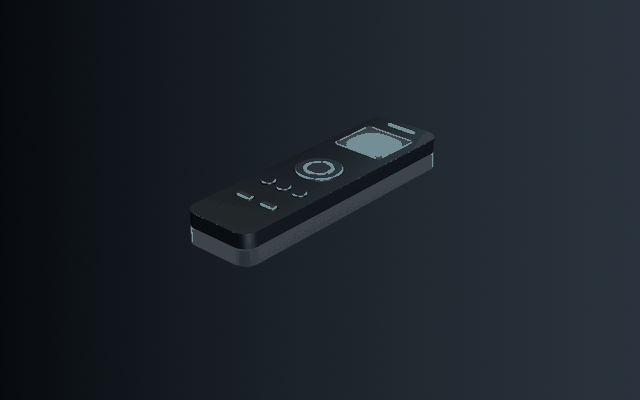
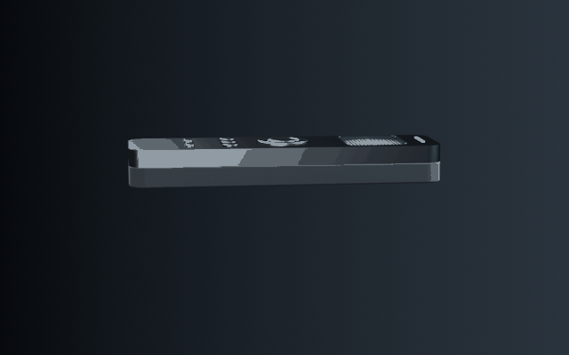
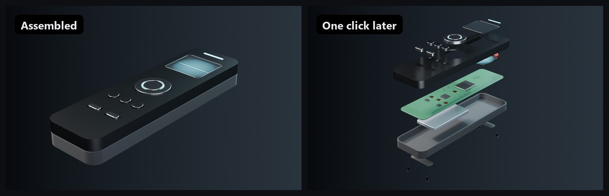
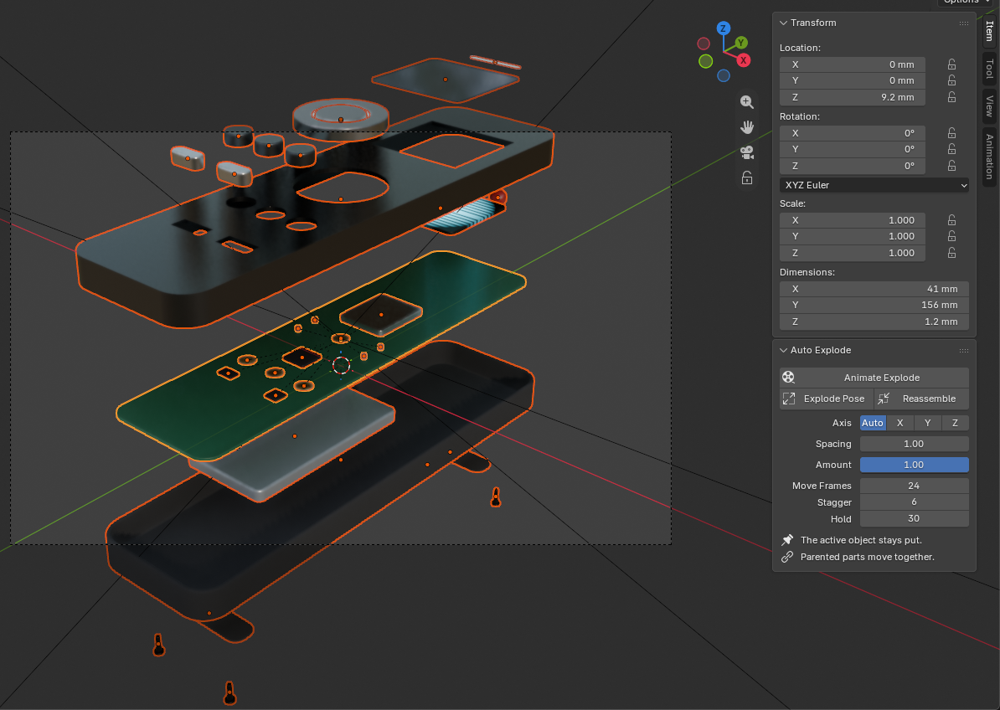
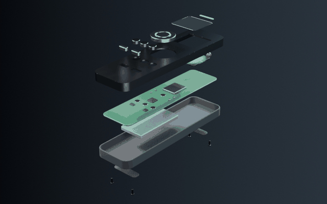

# Auto Explode

**One click from an assembly to an exploded view.** Select the parts of a product, click **Animate Explode**, and Blender keyframes them flying apart layer by layer, holding, and reassembling, as a seamless loop.



Free and open source. Blender 4.2+.

## What makes it different

Most explode tools push every part straight out from the center, so inner parts fly through outer ones. Auto Explode works out **what covers what**:

- The **top shell covers the screen**, which covers the circuit board, so the shell travels farther than the screen.
- **Outer parts leave first and come back last**, the way you'd actually take a product apart.
- **Screws come out before anything else** (parts named *screw, bolt, nut, rivet, washer, fastener*).
- **Parented parts move together**, so chips stay on their circuit board.
- **The active object stays put.** Click the part that should anchor the view last.



For the demo remote it finds 21 parts in 4 layers:

| Moves | Parts |
|---|---|
| ↑ 3 | glass, D-pad, buttons, LED strip |
| ↑ 2 | top shell |
| ↑ 1 | OLED display, IR lens |
| stays | circuit board (active object), with its chips |
| ↓ 1 | battery |
| ↓ 2 | bottom shell |
| ↓ 3 | rubber feet |
| ↓ 4, first out | 4 screws |



## Install

1. Download `auto_explode-<version>.zip` from [Releases](../../releases), or build it with `python build.py`.
2. **Edit → Preferences → Get Extensions → ⌄ → Install from Disk…** and pick the zip.

## Use

1. Select every part of the assembly. Click the part that should stay still **last**, so it's the active object.
2. Open the **Explode** tab in the 3D viewport sidebar (`N`).
3. Click **Animate Explode** and press play.

| Button / setting | What it does |
|---|---|
| **Animate Explode** | Keyframes explode → hold → reassemble and sets the scene's frame range. Loops seamlessly. |
| **Explode Pose** | Spreads the parts apart without keyframes, for still renders. *Amount* controls how far. |
| **Reassemble** | Removes Auto Explode's offsets and keyframes. Your own animation is left alone. |
| **Axis** | *Auto* uses the assembly's thinnest direction, which is how most products stack. Or force X, Y or Z. |
| **Spacing** | Gap between layers, relative to the assembly's thickness. |
| **Move Frames / Stagger / Hold** | How long each part travels, the delay between layers, and how long the exploded view holds. |



*The panel lives in the sidebar's **Explode** tab.*

**Non-destructive:** parts are moved with Blender's *delta* transforms, so their real location and any animation you've made stay untouched. Hidden helpers, such as boolean cutters, are ignored and ride along with their parent.



## The demo model

The remote controller is built entirely by [`examples/remote_controller.py`](examples/remote_controller.py), at real-world size (170 × 48 × 21 mm), with bevels, real materials and parented internals. Build it yourself:

```
blender -P examples/remote_controller.py
```

## Development

```
blender -b --factory-startup -P tests/test_auto_explode.py
python build.py
```

The images and GIFs are rendered, not mocked up. `docs/images/render.py` builds the remote, runs Auto Explode on it and renders the frames; it fails if the explode order isn't the expected stack. `docs/images/compose.py` turns the frames into GIFs.

```
blender -b --factory-startup -P docs/images/render.py
python docs/images/compose.py
```

## Credits

Built with [Blender](https://www.blender.org) and its Python API by the Blender Foundation. The README images are laid out with [Pillow](https://python-pillow.org).

## License

MIT
